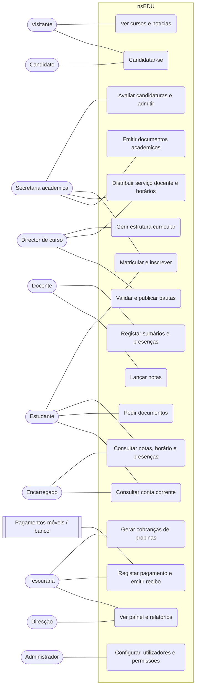
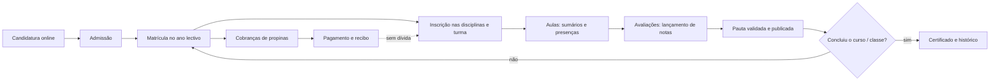

# Casos de uso

O que cada actor pode fazer, módulo a módulo, com o endereço e a permissão previstos. Segue o formato de `docs/monografia/casos-de-uso.md` do nsERP: quando o sistema existir, este documento passa a ser gerado a partir das rotas (`php artisan nsedu:documentacao`).

Os diagramas estão em Mermaid: o GitHub e o VS Code mostram-nos; para a monografia, cole cada um em https://mermaid.live e exporte em PNG ou SVG.

## 1. Diagrama geral

## 2. Fluxo principal: da candidatura ao certificado

## 3. Descrição dos casos de uso principais

### UC4 — Matricular e inscrever

| | |
|---|---|
| Actores | Secretaria académica (principal), Estudante (pedido online) |
| Pré-condições | Ano lectivo aberto; estudante sem matrícula activa no mesmo ano; período de inscrições a decorrer |
| Fluxo principal | 1. A secretaria abre a ficha do estudante e escolhe **Nova matrícula**. 2. Indica o curso / classe, o ano curricular e o turno; o sistema propõe o plano curricular em vigor. 3. O sistema verifica a dívida (RN-14) e cria a matrícula em rascunho. 4. Ensino superior: o sistema mostra as disciplinas a que o estudante pode ir (RN-05) e a secretaria marca-as. Ensino geral: entram todas as da classe. 5. A secretaria escolhe a turma de cada disciplina (ou o sistema distribui). 6. **Confirmar**: a matrícula fica activa e o sistema gera as cobranças do ano (UC13). |
| Alternativas | 3a. Dívida acima do limite → a matrícula não avança e o ecrã mostra o valor em falta. 4a. Precedência não cumprida → a disciplina aparece bloqueada com o motivo. 5a. Turma cheia → o sistema propõe outra do mesmo turno. |
| Pós-condições | Matrícula activa, inscrições criadas, cobranças geradas, registo na auditoria. |

### UC8 — Lançar notas

| | |
|---|---|
| Actores | Docente |
| Pré-condições | Distribuição de serviço feita; plano de avaliação definido (pesos somam 100 %); pauta em rascunho |
| Fluxo principal | 1. O docente abre **As minhas turmas** e escolhe a disciplina / turma. 2. Escolhe a componente (ex.: Teste 1). 3. Escreve ou cola as notas na folha; o sistema valida a escala (0–20). 4. **Guardar**: as notas ficam gravadas e a média de frequência é recalculada. 5. Quando todas as componentes estão lançadas, **Submeter pauta**. |
| Alternativas | 3a. Nota fora da escala → a célula fica a vermelho e não se grava. 5a. Faltam notas → o sistema lista os estudantes em falta e não deixa submeter. |
| Pós-condições | Notas gravadas e na auditoria; pauta submetida para validação (UC9). |

### UC9 — Validar e publicar pautas

| | |
|---|---|
| Actores | Director de curso (ou de turma) |
| Fluxo principal | 1. Abre **Pautas por validar**. 2. Revê a pauta (média, situação de cada estudante, distribuição de notas). 3. **Validar** → a pauta recebe número; **Publicar** → as notas aparecem nos portais e os estudantes são avisados. 4. No fim da época, **Fechar**. |
| Alternativas | 2a. **Devolver ao docente** com um comentário → a pauta volta a rascunho. |
| Pós-condições | Pauta publicada não se altera (RN-09); só por revisão de nota. |

### UC14 — Registar pagamento e emitir recibo

| | |
|---|---|
| Actores | Tesouraria; sistema de pagamentos (na fase do pagamento online) |
| Fluxo principal | 1. A tesouraria procura o estudante (nome, número, BI). 2. Vê a conta corrente com as cobranças em aberto. 3. Indica o valor, o método (numerário, banco, M-Pesa, e-Mola, POS) e a referência. 4. O sistema distribui o valor pelas cobranças mais antigas (RN-13), propondo; a tesouraria pode mudar. 5. **Confirmar** → recibo numerado (RC2026/0001), impressão e envio por e-mail. |
| Alternativas | 3a. Valor acima do devido → fica como crédito do estudante. 5a. Engano → anula-se o recibo com motivo (o número não se reutiliza). |
| Pós-condições | Cobranças pagas (total ou parcialmente), recibo emitido e assinado, bloqueios por dívida levantados. |

### UC11 / UC12 — Pedir e emitir documentos

| | |
|---|---|
| Actores | Estudante (pede), Tesouraria (recebe o emolumento), Secretaria (emite) |
| Fluxo principal | 1. No portal, o estudante escolhe o documento (declaração de matrícula, certificado...) e a finalidade. 2. O sistema gera o emolumento. 3. Depois de pago, o pedido entra na fila da secretaria. 4. A secretaria confere e **Emite**: o documento sai com número, QR de verificação e os dados do sistema. 5. O estudante é avisado e levanta-o (ou descarrega o PDF). |
| Pós-condições | Documento emitido, verificável em `/verificar/{codigo}`. |

## 4. Casos de uso por módulo (endereços e permissões previstos)

Convenção do nsERP: cada rota do sistema interno exige uma permissão (`->middleware('can:...')`); os portais usam uma guarda própria (`estudante`, `candidato`).

### Estrutura académica

| Caso de uso | Endereço | Permissão | Perfis |
|---|---|---|---|
| Ver unidades orgânicas | `GET /unidades` | `estrutura.ver` | Direcção, Director de curso, Secretaria |
| Gerir unidades orgânicas | `POST/PUT/DELETE /unidades/{unidade}` | `estrutura.gerir` | Administrador |
| Ver / gerir cursos | `GET/POST/PUT /cursos` | `estrutura.ver` / `estrutura.gerir` | Direcção, Director de curso / Administrador |
| Ver / gerir disciplinas | `GET/POST/PUT /disciplinas` | `estrutura.ver` / `estrutura.gerir` | Director de curso |
| Criar versão do plano curricular | `POST /cursos/{curso}/planos` | `estrutura.gerir` | Director de curso |
| Aprovar plano curricular | `POST /planos/{plano}/aprovar` | `estrutura.aprovar` | Direcção |
| Gerir anos e períodos lectivos | `GET/POST/PUT /anos-lectivos` | `calendario.gerir` | Secretaria, Direcção |

### Candidaturas

| Caso de uso | Endereço | Permissão | Perfis |
|---|---|---|---|
| Abrir fase de candidaturas | `POST /fases-candidatura` | `candidaturas.gerir` | Secretaria, Direcção |
| Candidatar-se | `POST /candidatura` (portal) | guarda `candidato` | Candidato |
| Ver candidaturas | `GET /candidaturas` | `candidaturas.ver` | Secretaria, Direcção |
| Verificar / lançar nota de admissão | `PUT /candidaturas/{candidatura}` | `candidaturas.gerir` | Secretaria |
| Publicar resultados | `POST /fases-candidatura/{fase}/publicar` | `candidaturas.publicar` | Direcção |
| Admitir → criar estudante | `POST /candidaturas/{candidatura}/admitir` | `candidaturas.gerir` | Secretaria |

### Estudantes e matrículas

| Caso de uso | Endereço | Permissão | Perfis |
|---|---|---|---|
| Ver a lista / ficha | `GET /estudantes`, `GET /estudantes/{estudante}` | `estudantes.ver` | Secretaria, Direcção, Director de curso, Tesouraria |
| Criar / alterar | `POST /estudantes`, `PUT /estudantes/{estudante}` | `estudantes.gerir` | Secretaria |
| Importar do Excel | `GET/POST /estudantes/importar` | `estudantes.gerir` | Secretaria |
| Gerir encarregados | `POST /estudantes/{estudante}/encarregados` | `estudantes.gerir` | Secretaria |
| Nova matrícula | `POST /estudantes/{estudante}/matriculas` | `matriculas.criar` | Secretaria |
| Confirmar matrícula | `POST /matriculas/{matricula}/confirmar` | `matriculas.criar` | Secretaria |
| Suspender / anular / transferir | `POST /matriculas/{matricula}/estado` | `matriculas.estado` | Secretaria, Direcção |
| Inscrever em disciplinas | `POST /matriculas/{matricula}/inscricoes` | `inscricoes.gerir` | Secretaria |
| Confirmar inscrição semestral | `POST /inscricoes-periodo/{inscricao}/confirmar` | `inscricoes.gerir` | Secretaria |
| Comprovativo de inscrição (2.ª via) | `GET /inscricoes-periodo/{inscricao}/comprovativo` | `inscricoes.gerir` | Secretaria |
| Aprovar pedido de inscrição online | `POST /inscricoes/pedidos/{pedido}/aprovar` | `inscricoes.aprovar` | Secretaria, Director de curso |
| Distribuir por turmas | `POST /turmas/{turma}/distribuir` | `turmas.gerir` | Secretaria |

### Docentes, horários e aulas

| Caso de uso | Endereço | Permissão | Perfis |
|---|---|---|---|
| Gerir docentes | `GET/POST/PUT /docentes` | `docentes.gerir` | Direcção, Secretaria |
| Distribuição de serviço | `GET/PUT /periodos/{periodo}/distribuicao` | `distribuicao.gerir` | Director de curso |
| Montar horário | `GET/PUT /turmas/{turma}/horario` | `horarios.gerir` | Secretaria, Director de curso |
| As minhas turmas | `GET /minhas-turmas` | `aulas.registar` | Docente |
| Registar sumário e presenças | `POST /leccionacoes/{leccionacao}/aulas` | `aulas.registar` | Docente (só as suas) |
| Anexar materiais à aula | `POST /aulas/{aula}/materiais` | `aulas.registar` | Docente (só as suas) |
| Justificar faltas | `POST /presencas/{presenca}/justificar` | `presencas.justificar` | Secretaria, Director de turma |

### Avaliação e pautas

| Caso de uso | Endereço | Permissão | Perfis |
|---|---|---|---|
| Definir plano de avaliação | `PUT /leccionacoes/{leccionacao}/avaliacao` | `notas.lancar` | Docente (só as suas) |
| Lançar notas | `PUT /leccionacoes/{leccionacao}/notas` | `notas.lancar` | Docente (só as suas) |
| Submeter pauta | `POST /pautas/{pauta}/submeter` | `notas.lancar` | Docente |
| Devolver / validar / publicar | `POST /pautas/{pauta}/{accao}` | `pautas.validar` | Director de curso |
| Fechar pauta | `POST /pautas/{pauta}/fechar` | `pautas.fechar` | Secretaria |
| Revisão de nota | `POST /notas/{nota}/revisao` | `pautas.rever` | Director de curso, Direcção |
| Conselho de notas (ensino geral) | `GET/POST /turmas/{turma}/conselho` | `pautas.validar` | Director de turma |
| Imprimir pauta | `GET /pautas/{pauta}/imprimir` | `pautas.ver` | Docente, Director de curso, Secretaria |

### Finanças do estudante

| Caso de uso | Endereço | Permissão | Perfis |
|---|---|---|---|
| Tabela de preços | `GET/PUT /financas/precos` | `financas.configurar` | Tesouraria, Direcção |
| Gerar cobranças do ano | `POST /financas/cobrancas/gerar` | `cobrancas.gerar` | Tesouraria |
| Ver cobranças e conta corrente | `GET /cobrancas`, `GET /estudantes/{estudante}/conta` | `financas.ver` | Tesouraria, Direcção |
| Bolsas e descontos | `POST /estudantes/{estudante}/descontos` | `descontos.gerir` | Direcção |
| Registar pagamento | `POST /estudantes/{estudante}/pagamentos` | `pagamentos.registar` | Tesouraria |
| Imprimir recibo | `GET /pagamentos/{pagamento}/recibo` | `financas.ver` | Tesouraria |
| Anular recibo | `POST /pagamentos/{pagamento}/anular` | `pagamentos.anular` | Direcção |
| Devedores | `GET /financas/devedores` | `financas.ver` | Tesouraria, Direcção |
| Carregar ficheiro do banco (baixa automática pelas referências) | `POST /financas/ficheiros-banco` | `pagamentos.registar` | Tesouraria |

### Documentos académicos

| Caso de uso | Endereço | Permissão | Perfis |
|---|---|---|---|
| Pedir documento | `POST /portal/pedidos` | guarda `estudante` | Estudante |
| Ver pedidos | `GET /pedidos-documentos` | `documentos.ver` | Secretaria |
| Emitir documento | `POST /pedidos-documentos/{pedido}/emitir` | `documentos.emitir` | Secretaria |
| Verificar autenticidade | `GET /verificar/{codigo}` | público | Qualquer pessoa |

### Portal do estudante e do encarregado (guarda `estudante`)

| Caso de uso | Endereço |
|---|---|
| Início (avisos, próximas aulas, dívida) | `GET /portal` |
| Inscrição semestral e comprovativo (2.ª via) | `GET/POST /portal/inscricao`, `GET /portal/inscricao/{inscricao}/comprovativo` |
| Notas de frequência (por ano e semestre) | `GET /portal/notas/frequencia` |
| Exames: normal, recorrência, especial | `GET /portal/notas/exames` |
| Plano curricular | `GET /portal/plano` |
| Aulas e materiais | `GET /portal/aulas`, `GET /portal/materiais/{material}` |
| Referências bancárias | `GET /portal/financas/referencias` |
| Inscrição na graduação | `POST /portal/graduacao` |
| Dados pessoais e alterar senha | `GET/PUT /portal/dados`, `PUT /portal/senha` |
| Escolher educando (encarregado) | `POST /portal/educando/{estudante}` |
| Horário | `GET /portal/horario` |
| Presenças | `GET /portal/presencas` |
| Conta corrente e recibos | `GET /portal/financas` |
| Pedidos de documentos | `GET/POST /portal/pedidos` |

### Administração (igual ao nsERP)

| Caso de uso | Endereço | Permissão | Perfis |
|---|---|---|---|
| Configuração da instituição | `GET/POST /administracao/configuracao/instituicao` | `configuracao.gerir` | Administrador |
| Regras pedagógicas | `GET/PUT /administracao/configuracao/avaliacao` | `configuracao.gerir` | Administrador |
| Numeração | `GET /administracao/configuracao/numeracao` | `configuracao.gerir` | Administrador |
| Utilizadores | `GET/POST/PUT /administracao/utilizadores` | `utilizadores.gerir` | Administrador |
| Perfis e permissões | `GET/POST/PUT/DELETE /administracao/perfis` | `perfis.gerir` | Administrador |
| Auditoria | `GET /administracao/auditoria` | `auditoria.ver` | Administrador, Direcção |
| Enviar SMS (um, todos, perfil, curso, admitidos) | `GET/POST /comunicacao/sms` | `sms.enviar` | Secretaria, Direcção |
| Cópias de segurança | `GET/POST /administracao/copias` | `copias.gerir` | Administrador |

## 5. Perfis de origem

O Administrador tem todas as permissões. Os outros perfis são criados pelo sistema e alteram-se em Administração → Perfis e permissões (Spatie Permission, como no nsERP).

| Permissão | Direcção | Director de curso | Secretaria | Docente | Tesouraria |
|---|---|---|---|---|---|
| `estrutura.ver` | ✓ | ✓ | ✓ | | |
| `estrutura.gerir` | | ✓ | | | |
| `estrutura.aprovar` | ✓ | | | | |
| `calendario.gerir` | ✓ | | ✓ | | |
| `candidaturas.ver` / `.gerir` | ✓ | | ✓ | | |
| `candidaturas.publicar` | ✓ | | | | |
| `estudantes.ver` | ✓ | ✓ | ✓ | | ✓ |
| `estudantes.gerir` | | | ✓ | | |
| `matriculas.criar` / `inscricoes.gerir` | | | ✓ | | |
| `matriculas.estado` | ✓ | | ✓ | | |
| `inscricoes.aprovar` | | ✓ | ✓ | | |
| `turmas.gerir` / `horarios.gerir` | | ✓ | ✓ | | |
| `docentes.gerir` | ✓ | | ✓ | | |
| `distribuicao.gerir` | | ✓ | | | |
| `aulas.registar` / `notas.lancar` | | | | ✓ | |
| `presencas.justificar` | | ✓ | ✓ | | |
| `pautas.ver` | ✓ | ✓ | ✓ | ✓ | |
| `pautas.validar` / `pautas.rever` | ✓ | ✓ | | | |
| `pautas.fechar` | | | ✓ | | |
| `financas.ver` | ✓ | | | | ✓ |
| `financas.configurar` | ✓ | | | | ✓ |
| `cobrancas.gerar` / `pagamentos.registar` | | | | | ✓ |
| `descontos.gerir` / `pagamentos.anular` | ✓ | | | | |
| `documentos.ver` / `.emitir` | | | ✓ | | |
| `auditoria.ver` | ✓ | | | | |
