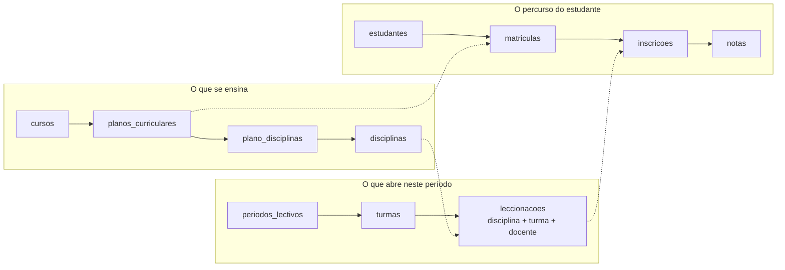
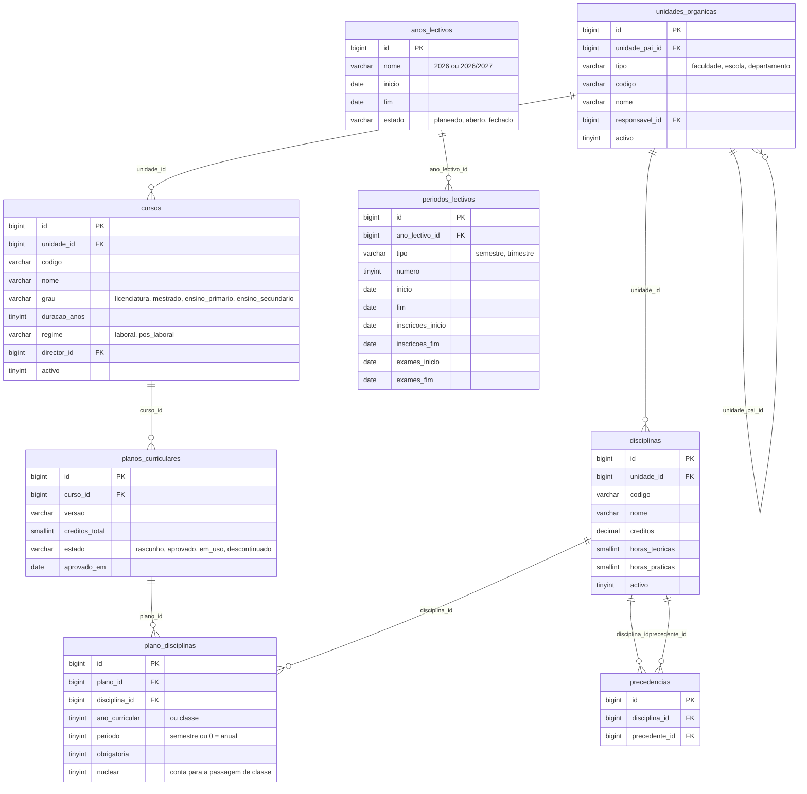
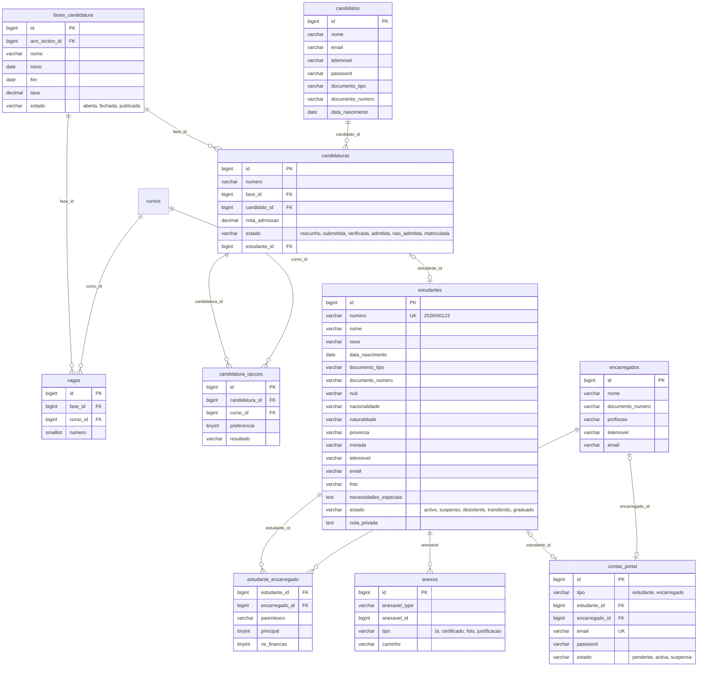
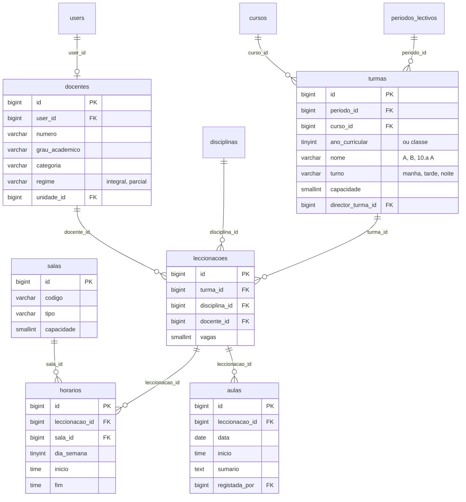
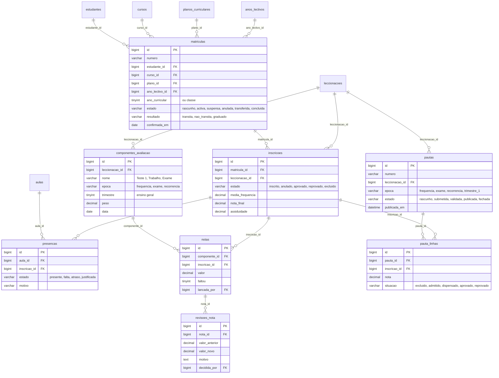
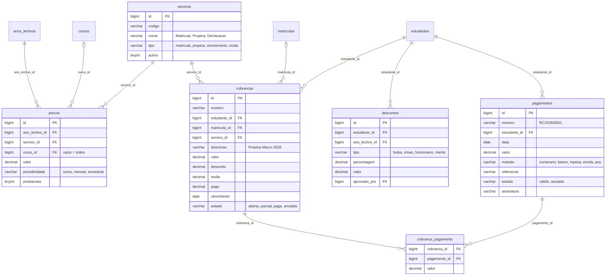
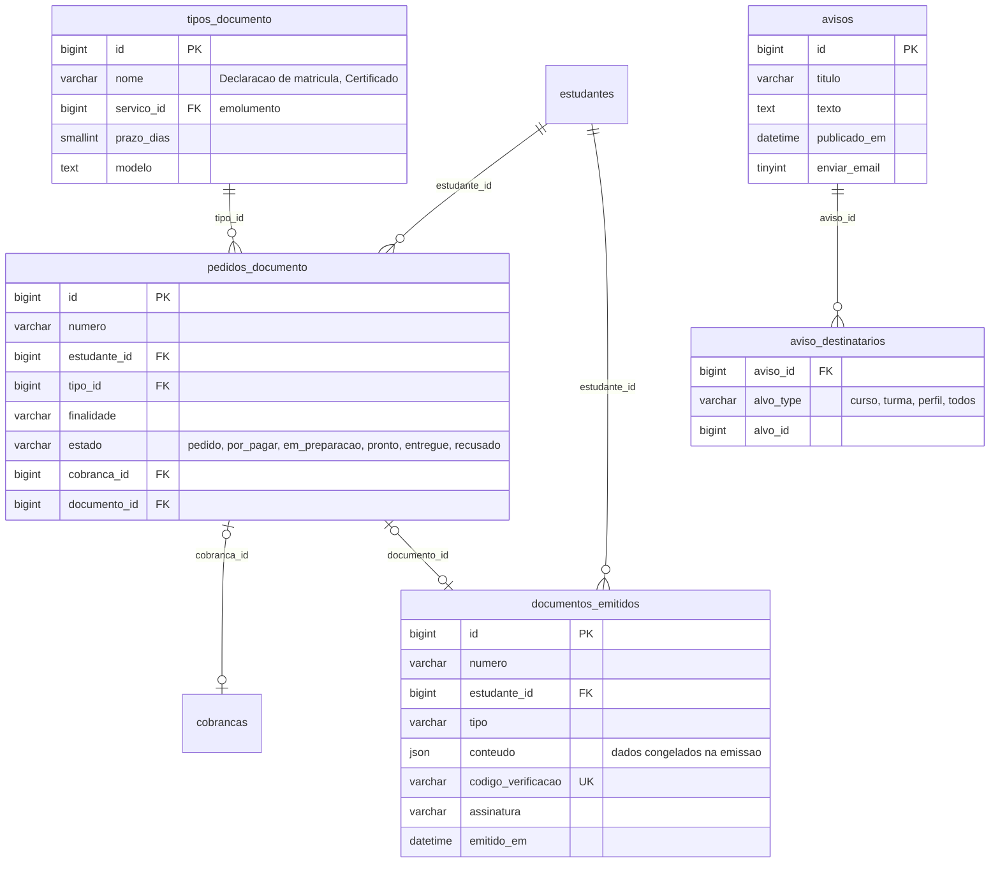

# Base de dados (modelo conceptual)

Modelo de dados proposto, agrupado por módulo. É o ponto de partida para as migrações; quando o sistema existir, este documento passa a ser gerado a partir das tabelas (como `docs/monografia/base-de-dados.md` do nsERP).

Convenções (as do nsERP): chave primária `id`; nomes de tabelas e campos em português, no plural e em `snake_case`; dinheiro em `decimal(15,2)`; notas em `decimal(5,2)`; datas em `date`; estados em `varchar` com os valores numa enumeração PHP; os documentos guardam quem criou e validou (`criado_por`, `validado_por` → `users`), ligações que não aparecem nos diagramas para não os encher.

## 1. Ideia central

Três camadas que não se misturam:

- **Curricular**: muda raramente e tem versões. Um estudante fica preso ao plano em que entrou.
- **Oferta**: criada todos os períodos. Uma **leccionação** é uma disciplina dada a uma turma, num período, por um docente; é aí que se pendura o horário, as aulas, o plano de avaliação e a pauta.
- **Percurso**: tudo o que diz respeito a um estudante. A **inscrição** liga o estudante a uma leccionação; as notas e as presenças pertencem à inscrição.

## 2. Estrutura académica

## 3. Candidaturas, estudantes e encarregados

As contas de acesso aos portais ficam em `contas_portal`, com guarda própria (`estudante`), como as `contas_cliente` do nsERP: nunca abrem o sistema interno. Os candidatos têm a sua guarda (`candidato`).

## 4. Oferta lectiva: turmas, docentes, horários

## 5. Matrícula, inscrição, presenças e avaliação

## 6. Finanças do estudante

Segue o modelo de facturação do nsERP: a **cobrança** faz o papel da factura (linhas com o serviço e o valor) e liga-se aos pagamentos por uma tabela intermédia com o valor abatido.

## 7. Documentos académicos e comunicação

## 8. Tabelas herdadas do nsERP

Vêm iguais (ou quase) da base do nsERP e não se desenham aqui: `users`, `roles`, `permissions` e tabelas de ligação (Spatie Permission), `activity_log` (Spatie Activitylog), `definicoes`, `numeracoes`, `sessions`, `cache`, `jobs`, `failed_jobs`, `notifications`, `password_reset_tokens`.
