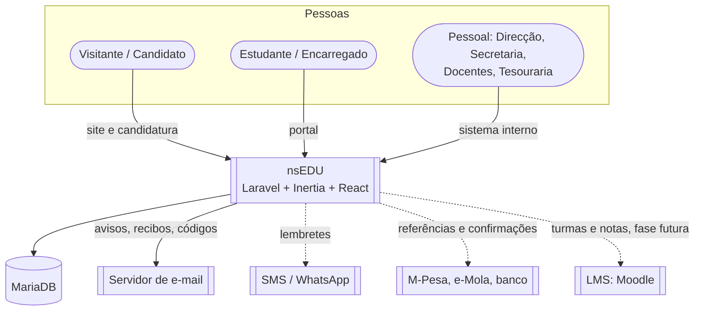
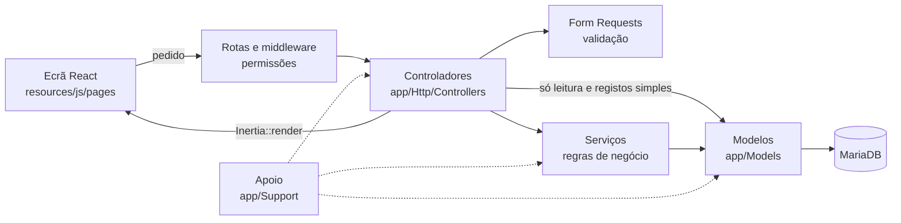
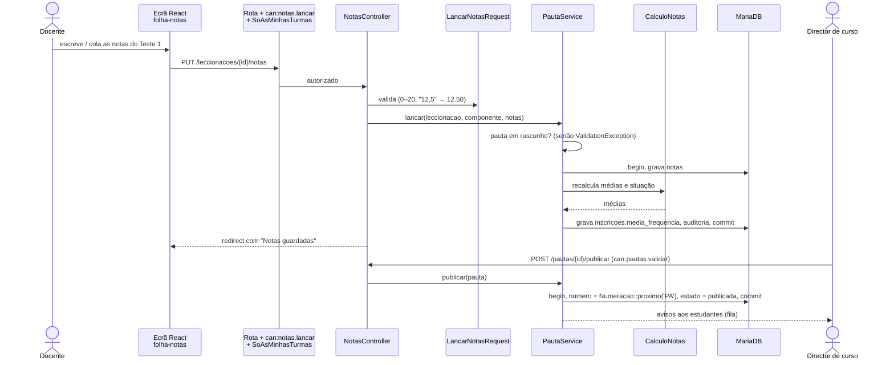
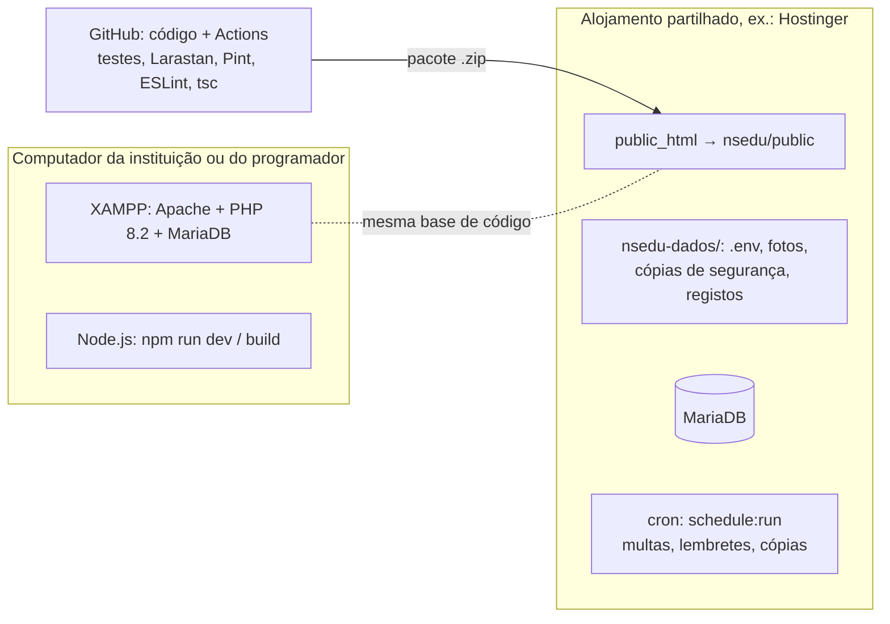

# Arquitectura

O nsEDU usa **o mesmo stack e a mesma arquitectura do nsERP**: uma só aplicação Laravel 12 com o ecrã em React 19, ligados pelo Inertia 2. O servidor escolhe o ecrã e os dados, o React desenha-o. Não há uma API à parte (só a dos pagamentos, mais tarde).

## 1. Tecnologias

| Camada | Tecnologia | Igual ao nsERP |
|---|---|---|
| Frontend | React 19 + TypeScript 5, Tailwind CSS 4, componentes shadcn/ui (Radix), ícones lucide-react, gráficos Recharts, avisos sonner | ✓ |
| Ligação frontend/backend | Inertia.js 2, rotas no ecrã com Ziggy | ✓ |
| Backend | Laravel 12 (PHP 8.2+) | ✓ |
| Base de dados | MariaDB 10.4+ (XAMPP no local, MySQL/MariaDB no alojamento); SQLite em memória nos testes | ✓ |
| Compilação do frontend | Vite 6 com `laravel-vite-plugin` | ✓ |
| Filas e tarefas | Fila na base de dados (`QUEUE_CONNECTION=database`) e o agendador do Laravel (cron) | ✓ |

### Pacotes

| Pacote | Para quê no nsEDU | Igual ao nsERP |
|---|---|---|
| `spatie/laravel-permission` | Perfis e permissões (Direcção, Secretaria, Docente, Tesouraria...) | ✓ |
| `spatie/laravel-activitylog` | Auditoria de notas, pagamentos e estados | ✓ |
| `pragmarx/google2fa` | Verificação em dois passos do pessoal | ✓ |
| `bacon/bacon-qr-code` | QR de verificação nos certificados, declarações e recibos | ✓ |
| `openspout/openspout` | Importar estudantes e notas do Excel; exportar listas e pautas | ✓ |
| `laravel/socialite` | "Entrar com Google" nos portais (opcional) | ✓ |
| `tightenco/ziggy` | Rotas do Laravel no React | ✓ |
| `larastan/larastan`, `laravel/pint`, `phpunit/phpunit` | Análise estática, formatação e testes | ✓ |
| `eslint`, `prettier`, `typescript` | Qualidade do frontend | ✓ |
| (novo) geração de PDF | Pautas, boletins e certificados em PDF (a escolher: impressão do navegador como no nsERP, ou `barryvdh/laravel-dompdf`) | — |

## 2. Contexto

## 3. As quatro caras da aplicação

Tal como o nsERP tem três caras (ERP, site, área do cliente), o nsEDU tem quatro, todas na mesma aplicação:

| Cara | Quem usa | Rotas | Guarda | Esqueleto do ecrã |
|---|---|---|---|---|
| Sistema interno | Direcção, secretaria, docentes, tesouraria, administrador | `routes/web.php`, `routes/auth.php`, `routes/settings.php` | `web` (users) | `layouts/app-layout.tsx` |
| Portal do estudante e do encarregado | Estudantes e encarregados com conta activa | `routes/portal.php` | `estudante` (`contas_portal`) | `layouts/portal-layout.tsx` |
| Portal do candidato | Candidatos | `routes/candidatura.php` | `candidato` | `layouts/candidatura-layout.tsx` |
| Site público | Visitantes | `routes/site.php` | — | `layouts/site-layout.tsx` |

O docente **não** tem um portal à parte: entra no sistema interno com o perfil Docente e vê só "As minhas turmas", "Horário" e "Avisos", porque as permissões escondem o resto.

## 4. Camadas

As regras são as do nsERP e ficam escritas num teste de arquitectura (`tests/Unit/ArquitecturaTest.php`):

- Cada camada só usa as de baixo. Um modelo não conhece os serviços nem o HTTP; um serviço não conhece os pedidos.
- Cada rota do sistema interno exige uma permissão (`->middleware('can:notas.lancar')`).
- Os controladores não usam `DB::` e não chamam outros controladores; escolhem um a um os campos que vão para o ecrã (nunca o modelo inteiro). Os portais nunca recebem notas internas nem notas por publicar.
- Tudo o que muda mais do que um registo corre num serviço, numa transacção, e fica na auditoria.

### Rotas e middleware

| Middleware | Para quê | Origem |
|---|---|---|
| `GarantirUtilizadorActivo`, `ExigirDoisPassos`, `CabecalhosSeguranca`, `SistemaInterno` | Entrada segura do pessoal | nsERP |
| `GarantirContaActiva` | O portal só abre com a conta activa | nsERP (adaptado) |
| `EducandoSeleccionado` | O encarregado escolhe o educando; todas as páginas do portal mostram só os dados dele | novo |
| `SoAsMinhasTurmas` | O docente só abre leccionações da sua distribuição de serviço (RN-10) | novo |
| `BloqueioPorDivida` | Aplica os bloqueios configurados (RN-14) | novo |

### Módulos (pastas de `Controllers`, `Requests`, `pages`)

| Módulo | Controladores |
|---|---|
| `Estrutura` | Unidades, Cursos, Disciplinas, Planos, AnosLectivos, Salas |
| `Candidaturas` | Fases, Candidaturas, Resultados |
| `Academico` | Estudantes, Encarregados, Matriculas, Inscricoes, Turmas |
| `Docencia` | Docentes, Distribuicao, Horarios, Aulas (sumários e presenças) |
| `Avaliacao` | PlanosAvaliacao, Notas, Pautas, Revisoes, Conselhos |
| `Financas` | Precos, Cobrancas, Descontos, Pagamentos, Devedores |
| `Documentos` | Pedidos, Emissao, Verificacao |
| `Portal` | Inicio, Horario, Notas, Presencas, Financas, Pedidos, Inscricao |
| `Administracao` | Configuracao, Utilizadores, Perfis, Auditoria, Copias (do nsERP) |

### Serviços — `app/Services`

| Tipo | Serviços | Para quê |
|---|---|---|
| Ciclo de vida | `CandidaturaService`, `EstudanteService`, `MatriculaService`, `InscricaoService`, `PautaService`, `PedidoDocumentoService`, `PagamentoService` | criar, alterar, mudar de estado (rascunho → ...), anular |
| Regras académicas | `Precedencias`, `CalculoNotas` (médias, situação, arredondamento), `Assiduidade`, `PassagemClasse`, `Creditos` | as regras RN-01 a RN-07, com os valores de `Definicoes` |
| Oferta | `DistribuicaoTurmas`, `Horarios` (sobreposições de docente, sala e turma) | |
| Finanças | `GeradorCobrancas`, `Multas` (tarefa diária), `ContaCorrente`, `AlocacaoPagamentos` | cobranças do ano, multas, saldo, abate pelas mais antigas |
| Documentos | `EmissaoDocumentos` (dados congelados + QR) | |
| Herdados do nsERP | `Numeracao`, `IntegridadeDocumentos`, `VerificacaoDoisPassos`, `CopiasSeguranca`, `Importacao`, `UtilizadorService`, `EstadoSistema` | iguais ou quase |
| Relatórios | `Estatisticas`, `Aproveitamento`, `RelatorioFinanceiro` | só leitura |

Quando uma acção não é permitida (submeter uma pauta com notas em falta, inscrever sem a precedente...), o serviço lança uma `ValidationException` com a chave do registo (`pauta`, `inscricao`...) e a ficha mostra-a no topo com `ErroFicha` — como no nsERP.

### Modelos — `app/Models`

- `Estudante`, `Encarregado`, `Matricula`, `Inscricao`, `Leccionacao`, `Pauta`, `Nota`, `Cobranca`, `Pagamento`...
- Os estados são enumerações PHP (`EstadoMatricula`, `EstadoPauta`, `SituacaoAvaliacao`) com o rótulo e as transições permitidas.
- `paraEcra()`, `resumo()`, `referencia()` em cada modelo, como no nsERP.

### Apoio — `app/Support`

Do nsERP: `Dinheiro`, `Definicoes`, `Permissoes`, `Opcoes`, `Ordenacao`, `Pesquisa`, `Excel`, `Extenso`, `Imagem`, `Avisos`, `Telemovel`. Novos: `Escala` (ler e arredondar notas: `"12,5"` → `12.50`), `TipoInstituicao` (superior / geral, e os termos de cada um: Curso/Classe, Semestre/Trimestre, Disciplina/Disciplina da classe).

## 5. Regras que valem em todo o sistema

1. **Dinheiro** nunca com `float`: bcmath (`App\Support\Dinheiro`), `decimal(15,2)` na base. *(nsERP)*
2. **Notas** nunca com `float`: `decimal(5,2)`, contas em bcmath, arredondamento só no fim e da forma configurada (`App\Support\Escala`).
3. **Numeração** só por `Numeracao::proximo()`, dentro da transacção: n.º de estudante, matrícula, pauta, recibo, documento. *(nsERP)*
4. **Documentos e pautas** nascem em rascunho; só os rascunhos se alteram. Uma pauta publicada corrige-se por revisão; um recibo, por anulação com motivo. *(nsERP)*
5. **Auditoria** de cada acção dos serviços; os registos simples registam-se sozinhos (`LogsActivity`). *(nsERP)*
6. **Uma instituição por instalação**, nada dela no código: nome, logótipo, cores, tipo de instituição e regras pedagógicas estão em `definicoes`. *(nsERP)*
7. **Datas** viajam como `AAAA-MM-DD` e mostram-se com `formatData`. *(nsERP)*
8. **Testes** só em SQLite em memória; o `TestCase` recusa outra base. *(nsERP)*
9. **Privacidade**: cada consulta do portal filtra pelo estudante da sessão (ou pelo educando escolhido); o docente só vê as suas turmas. Há um teste por regra.

## 6. Frontend — `resources/js`

A mesma organização do nsERP:

| Pasta | O que tem |
|---|---|
| `pages/` | Só ecrãs; a pasta segue o endereço (`pages/pautas/mostrar.tsx` ↔ `/pautas/{id}`). |
| `components/erp.tsx` | A base dos ecrãs internos do nsERP: `TituloPagina`, `CabecalhoFicha`, `Separadores`, `Campos`, `Bloco`, `ErroFicha`, filtros e ordenação (`useListaFiltros`), etiquetas de estado. |
| `components/` | Peças novas: `folha-notas` (lançamento tipo Excel, com teclado e colar), `folha-presencas`, `grelha-horario`, `conta-corrente`, `documento-impresso` (pautas, boletins, certificados). |
| `components/ui/` | Os elementos base do shadcn/ui. |
| `hooks/` | `usePode` (permissões), `useTermos` (Curso/Classe, Semestre/Trimestre conforme o tipo de instituição), `useAvisos`, `useAppearance`... |
| `lib/` | `format` (números, dinheiro e datas à moçambicana), `navegacao` (o menu por perfil). |
| `layouts/` | `app-layout`, `portal-layout`, `candidatura-layout`, `site-layout`. |

## 7. Exemplo: lançar notas e publicar a pauta

## 8. Instalação e publicação

O mesmo esquema do nsERP (`deploy/hostinger/instalar.sh` e `actualizar.sh`): o programa numa pasta que cada actualização substitui e os dados numa pasta à parte que nunca se substitui.

## 9. Partir do nsERP

O nsEDU começa com a base do nsERP (o mesmo autor), em vez de um Laravel vazio. Vem já feito e testado:

| Leva do nsERP | Deixa para trás |
|---|---|
| Entrada, dois passos, utilizadores, perfis e permissões, auditoria | Terceiros, produtos, stock, aluguer |
| Configuração da instituição (`Definicoes`), marca e cores, temas claro e escuro | Orçamentos, encomendas, compras |
| Numeração, integridade dos documentos, impressão A4 | Loja e catálogo |
| Facturação e pagamentos → adaptados a cobranças e recibos | IVA (a propina é isenta; confirmar com o contabilista) |
| Cópias de segurança, importação do Excel, painel, CI no GitHub, instalação no Hostinger | |
| `components/erp.tsx`, `components/ui/`, `lib/format`, testes de arquitectura | |

## 10. Acrescentar um módulo novo

Os mesmos passos do nsERP:

1. As permissões em `Permissoes` (e em que perfis entram).
2. As rotas, cada uma com `can:`.
3. Um Form Request por formulário.
4. As regras num serviço, com transacção e auditoria.
5. Um controlador fino que liga tudo e escolhe os campos para o ecrã.
6. Os ecrãs em `pages/<módulo>/`, montados com `components/erp.tsx` e `components/ui/`.
7. Os testes em `tests/Feature/<Módulo>`. No fim, `composer verificar`.
