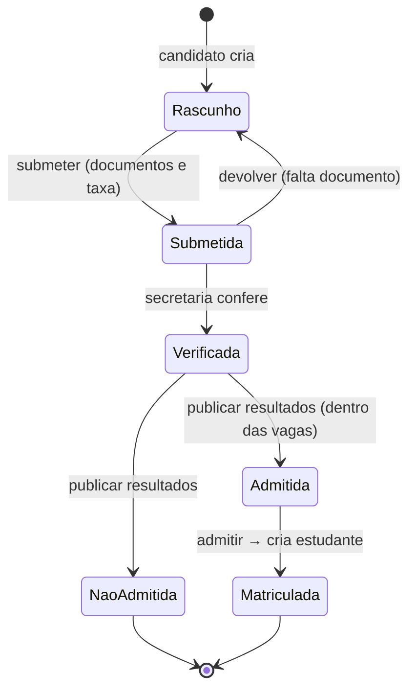
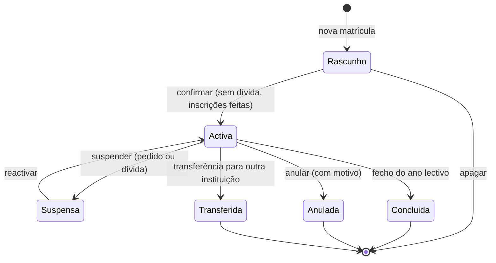
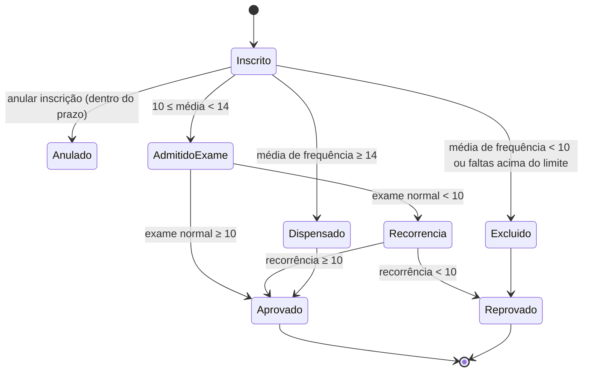
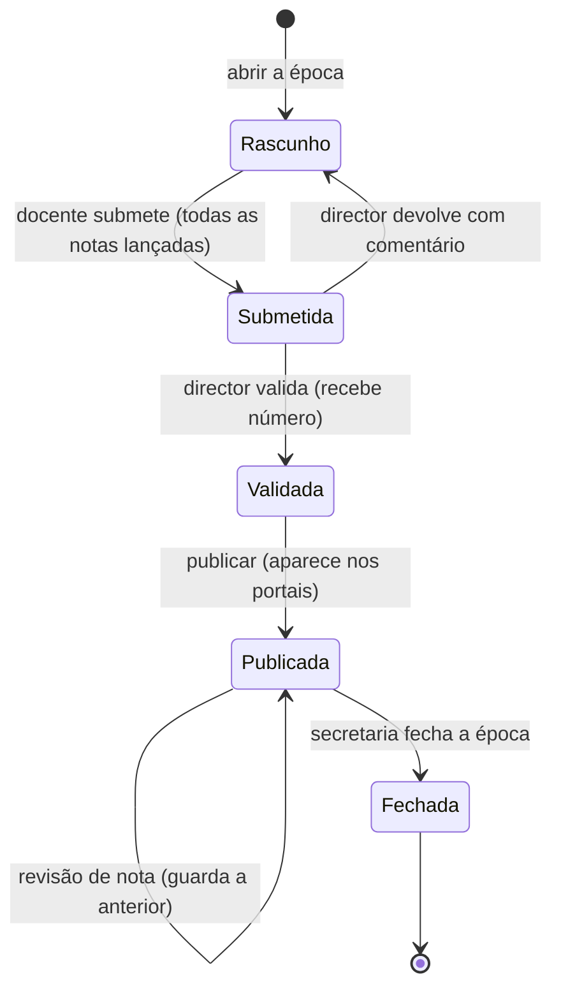
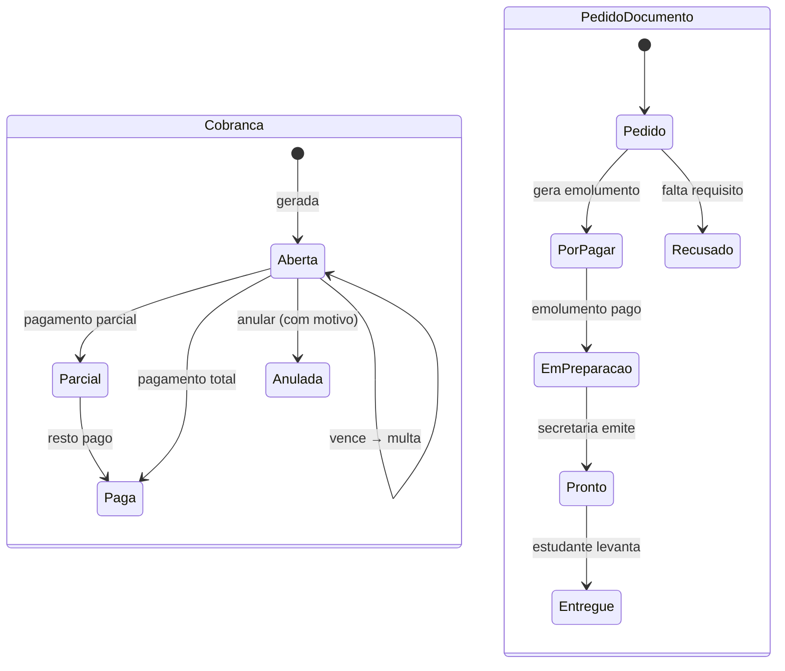
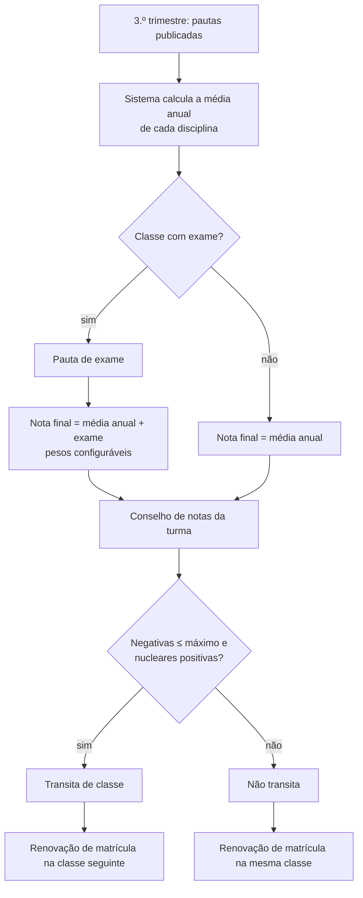
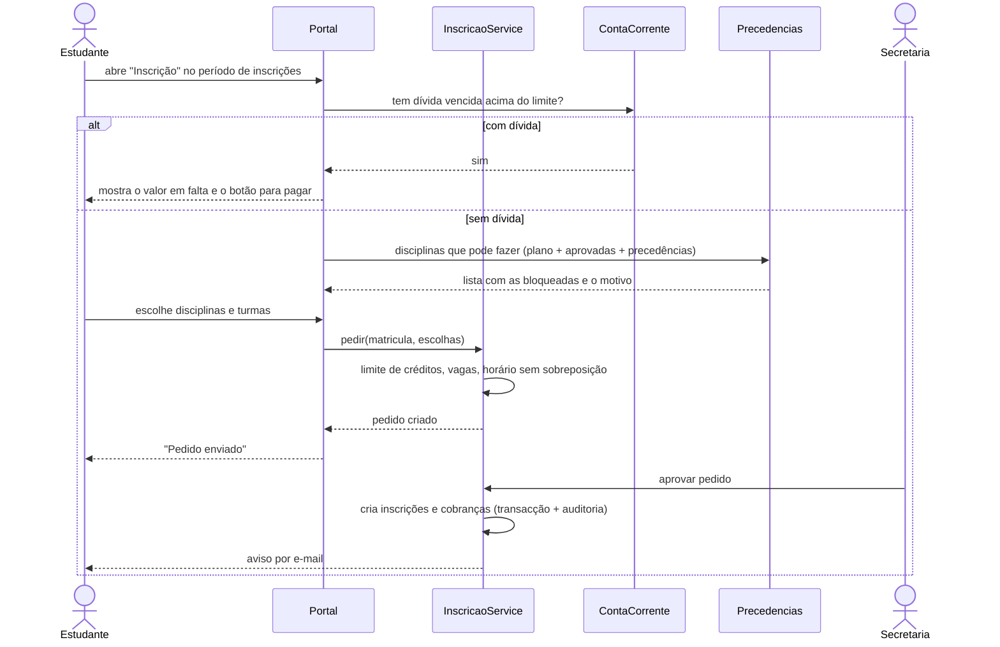
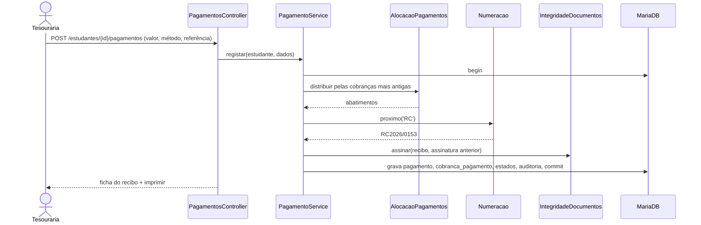

# Processos e estados

Diagramas de estado (ciclo de vida de cada registo) e de actividade / sequência dos processos principais. Cada transição é uma acção de um serviço, numa transacção, registada na auditoria.

## 1. Candidatura

## 2. Matrícula

No fecho do ano, a matrícula concluída recebe o **resultado**: transita, não transita ou graduado (fim do curso / da última classe).

## 3. Inscrição numa disciplina

Ensino superior, com os limites de origem (RN-02 a RN-04). No ensino geral, a inscrição fica "Inscrito" o ano todo e a decisão é da **passagem de classe** (secção 6).

## 4. Pauta

## 5. Cobrança e pedido de documento

## 6. Fim do ano lectivo (ensino geral)

## 7. Inscrição online pelo estudante (ensino superior)

## 8. Pagamento de propina na tesouraria

